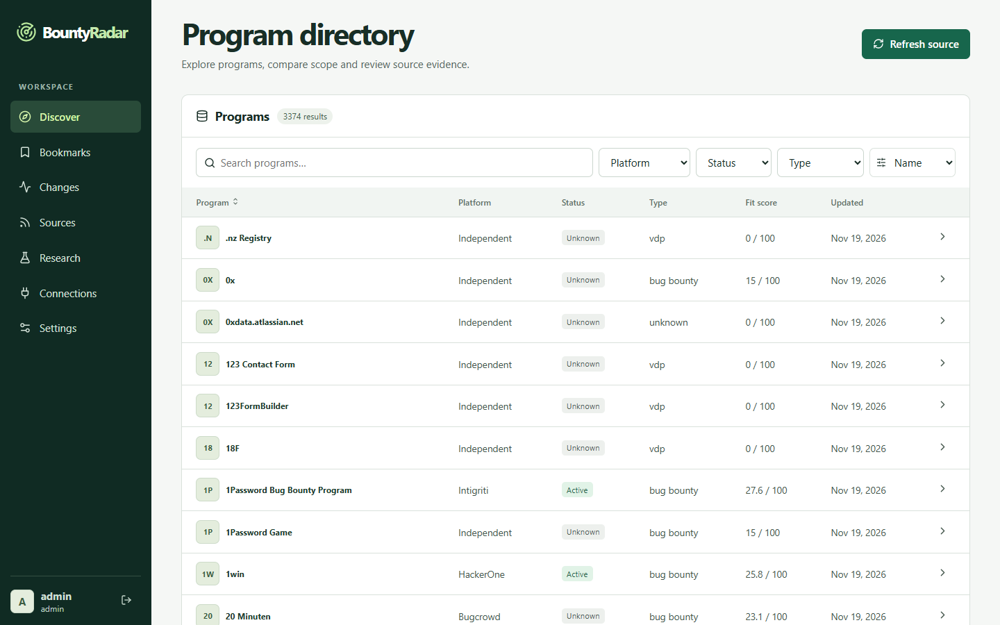

# Acceptance evidence

Release check on 19 November 2026: 25 backend tests passed with 80% statement coverage across the `radar` package. The Chrome and Compose checks below were run separately.

| Check | Procedure | Observed result |
| --- | --- | --- |
| New installation | Run the live slice script against a fresh temporary database. Login, queue refresh, load policy detail and re-open the stored database. | 52 real public YesWeHack records. The same snapshot ID was present in the export and database after reopening. |
| Five production feeds | Refresh the current Windows catalog through the authenticated API. | 52 YesWeHack, 295 Bugcrowd, 146 Intigriti, 448 HackerOne and 2,433 disclose.io records. These are catalog entries, not a count of unique organizations. |
| Desktop and mobile | Run `frontend/tests/browser.mjs` against the real local application in Chrome. | Passed login, directory, detail, ZIP download, keyboard table focus, navigation and 390px stacked table without page overflow. |
| Data integrity and permissions | Run pytest with a temporary SQLite database and controlled upstream responses. | Covers idempotent import, changes, unknowns, source outages, visibility filters, encryption, cross-account denial, CSRF, scoring, schedules, daily quotas, review and citation validation. |
| Authenticated external accounts | Use Connections → Test, then a manually triggered job. | Contract tested; live platform credentials and LLM/reader accounts were not supplied. |
| Release deployment | Run `sh scripts/verify-compose.sh` in an environment with Docker Compose v2, curl and Python 3. | Passed on Ubuntu in WSL. Caddy served the authenticated API. A Celery worker processed a Redis job, persisted 52 YesWeHack entries to PostgreSQL, and the API exported the workspace ZIP. |

Run dates, counts and external availability may differ. No production fixtures are loaded on startup. The dashboard preview is from the real local catalog.

